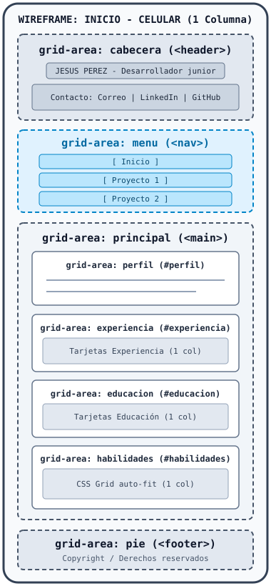
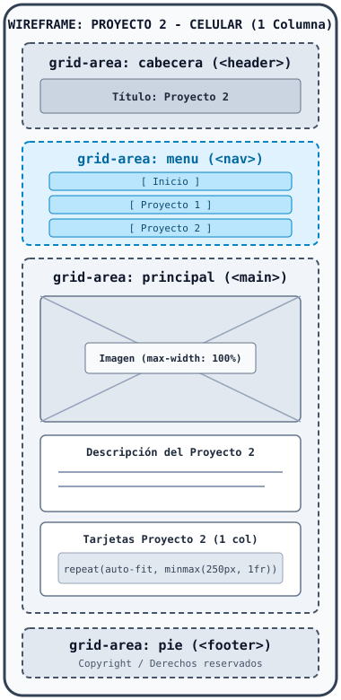

# Hoja de vida web Jesus Perez

## 🌐 Enlace a GitHub Pages

> **URL del proyecto desplegado:** [ pegar aquí la URL de GitHub Pages ]()

---

## 📄 Páginas del Proyecto

El sitio web está conformado por las siguientes **3 páginas** interconectadas mediante un menú de navegación semántico (`<nav>`) con rutas relativas y compartiendo la misma hoja de estilos (`styles.css`):

1. **`index.html`**: Página principal con la hoja de vida de **JESUS PEREZ** (Desarrollador junior), datos de contacto (correo, LinkedIn y GitHub), perfil profesional, experiencia laboral, educación y habilidades técnicas.
2. **`proyecto1.html`**: Página dedicada a la presentación detallada del primer proyecto de desarrollo de software.
3. **`proyecto2.html`**: Página dedicada a la presentación detallada del segundo proyecto de desarrollo de software.

---

## 📐 Fase 1: Mockups Estructurales (Wireframes)

A continuación se presentan los 6 bocetos estructurales en formato SVG que definen la distribución de áreas mediante `grid-template-areas` (`cabecera`, `menu`, `principal` y `pie`) tanto en dispositivos móviles como en computador:

### 1. Página de Inicio (`index.html`)

#### Vista Celular

#### Vista Computador

---

### 2. Página Proyecto 1 (`proyecto1.html`)

#### Vista Celular

#### Vista Computador

---

### 3. Página Proyecto 2 (`proyecto2.html`)

#### Vista Celular

#### Vista Computador

---

## ⚙️ Explicación Técnica: Diseño Responsivo y Breakpoints (CSS Grid)

El archivo `styles.css` está construido bajo la metodología **Mobile First** (sin usar `!important`), utilizando unidades relativas (`rem`, `%`, `vw`), imágenes adaptables (`max-width: 100%`) y tarjetas automáticas con `repeat(auto-fit, minmax(250px, 1fr))`.

La estructura principal del contenedor `body` emplea **`grid-template-areas`** y se adapta en los siguientes puntos de quiebre (*breakpoints*):

1. **Vista Móvil Base (`< 600px` - 1 sola columna)**:
   - Todos los bloques principales se apilan verticalmente en una única columna (`grid-template-columns: 1fr`) con el orden: `"cabecera"`, `"menu"`, `"principal"` y `"pie"`.
   - El menú de navegación y las tarjetas de contenido se muestran en disposición vertical para facilitar la lectura y el toque en pantallas pequeñas.

2. **Primer Breakpoint: `@media (min-width: 600px)` (Vista Tablet - 2 columnas)**:
   - El contenedor `body` pasa a dos columnas (`grid-template-columns: 13rem 1fr`).
   - Las áreas se reorganizan en:
     - Fila 1: `"cabecera cabecera"` (ocupa el ancho completo superior).
     - Fila 2: `"menu principal"` (el menú pasa a una columna lateral izquierda fija con `position: sticky`, mientras que el contenido principal se ubica a la derecha).
     - Fila 3: `"pie pie"` (ocupa el ancho completo inferior).

3. **Segundo Breakpoint: `@media (min-width: 1024px)` (Vista Computador / Escritorio - 3 columnas)**:
   - El contenedor `body` se expande a tres columnas (`grid-template-columns: 20rem 1fr 1fr`).
   - Las áreas se reorganizan en:
     - Fila 1: `"cabecera menu menu"` (la cabecera se fija como panel lateral izquierdo con la información de contacto, y el menú se despliega horizontalmente en la parte superior derecha).
     - Fila 2: `"cabecera principal principal"` (la cabecera continúa a la izquierda y el contenido principal ocupa las dos columnas derechas).
     - Fila 3: `"pie pie pie"` (el pie de página abarca las tres columnas inferiores).
   - Además, dentro de `main`, las secciones de **Experiencia** y **Educación** pasan a ubicarse lado a lado en dos columnas (`"experiencia educacion"`).

---

## 📸 Capturas de Pantalla Reales del Sitio Final

### Página de Inicio (`index.html`)
- **Vista Móvil:**
  <!-- Reemplazar la ruta con la captura de pantalla real -->
  `[ Insertar aquí captura de pantalla real: Inicio - Móvil ]`

- **Vista Computador:**
  <!-- Reemplazar la ruta con la captura de pantalla real -->
  `[ Insertar aquí captura de pantalla real: Inicio - Computador ]`

### Página Proyecto 1 (`proyecto1.html`)
- **Vista Móvil:**
  <!-- Reemplazar la ruta con la captura de pantalla real -->
  `[ Insertar aquí captura de pantalla real: Proyecto 1 - Móvil ]`

- **Vista Computador:**
  <!-- Reemplazar la ruta con la captura de pantalla real -->
  `[ Insertar aquí captura de pantalla real: Proyecto 1 - Computador ]`

### Página Proyecto 2 (`proyecto2.html`)
- **Vista Móvil:**
  <!-- Reemplazar la ruta con la captura de pantalla real -->
  `[ Insertar aquí captura de pantalla real: Proyecto 2 - Móvil ]`

- **Vista Computador:**
  <!-- Reemplazar la ruta con la captura de pantalla real -->
  `[ Insertar aquí captura de pantalla real: Proyecto 2 - Computador ]`

